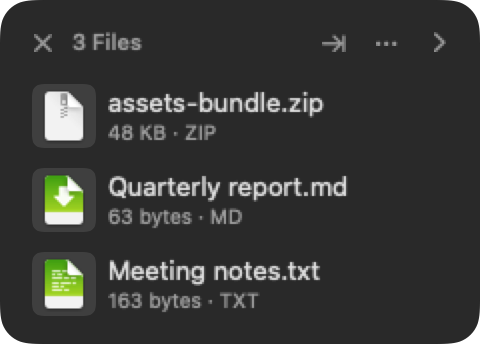
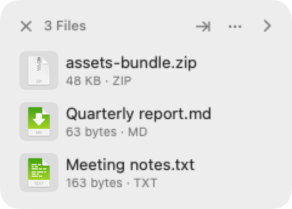
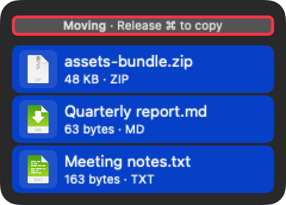
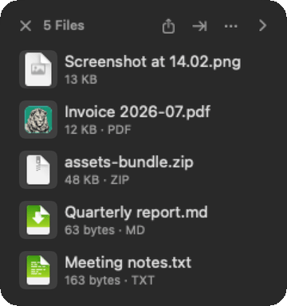

# Magpie

[](https://github.com/ABCastor/Magpie/actions/workflows/checks.yml)

Magpie is a file shelf for macOS. You drag files onto a small floating panel, go wherever you need to, and drag them back out: the second hand you do not have when a drag has to cross two windows, a Space, or an app that is not open yet.

It asks for no macOS permissions out of the box.

It began as a fork of an MIT-licensed upstream project and has diverged substantially since; the upstream copyright notice travels in [LICENSE](LICENSE).

<p>
  
  
</p>

The shelf follows the system appearance, with a System, Light or Dark override in Settings. Every picture in this README is an offscreen render of the real views, produced by `./scripts/make-images.sh`, so they change when the app does.

## Why

The polished file shelves for macOS are commercial, and none of them does what I kept needing. I built it for four things I was doing by hand: moving a file out of a folder instead of copying it, getting a pile of paths into a [Claude Code](https://claude.com/claude-code) session without typing one, handing that pile to a script I wrote, and binning the lot once the email was sent.

## What it saves you from

None of these is worth its own app. That is the point: they are small enough that everyone puts up with them, and they add up.

**The Desktop you keep using as a staging area.** You drag three files there because an email wants them attached. You attach them. A month later they are still sitting there and you no longer remember which of the twenty icons were the three. Put them on a shelf instead, attach from the shelf, then press ⌘⌫ and every file on it goes to the Bin at once. ⌘Z takes them back out, straight to the folders they came from. Dragging cards onto the Dock's Bin does the same thing, whether that is one file, several at once, or a whole folder.

**Dragging between two windows that will not both fit on screen.** Open the source, drop onto a shelf, close it, open the destination, drag out. The shelf floats above everything and survives every window you close underneath it.

**Collecting files that live in five different folders.** Walk to each one, drop it on the same shelf, and the shelf is now the set. Merge the PDFs, zip them, batch-rename them, or drag the whole pile into one upload field.

**Retyping paths into a terminal or a chat window.** ⌥⇧C, by default, puts the shelf on the clipboard as the files *and* as a plain list of full paths. Paste into Finder and you get files. Paste into a composer and you get text. You do not have to decide which before you copy, and no Magpie window needs to be in front.

**Wanting to move a file out of a folder rather than copy it.** Hold ⌘ while you drag out. The file lands at the destination and the original goes to the Bin, once Magpie has confirmed the copy arrived and is the same size. If it cannot confirm, it says so and leaves your file alone. The shelf tells you which mode you are in while you drag, and how to change your mind:



## Install

### Pre-built DMG

Latest release: <https://github.com/ABCastor/Magpie/releases/latest>

```sh
curl -L -o ~/Downloads/Magpie.dmg \
  https://github.com/ABCastor/Magpie/releases/latest/download/Magpie.dmg
open ~/Downloads/Magpie.dmg
# Drag Magpie.app to /Applications, eject the DMG, then:
open /Applications/Magpie.app
```

Magpie lives in your menubar. Click the icon for a shelf, right-click for the menu, or use any of the four summon triggers below.

**If macOS refuses to open it** ("Magpie is damaged" or "cannot be opened"), the release you downloaded was ad-hoc signed rather than notarized, so Gatekeeper quarantined it. Clear the flag once per machine:

```sh
xattr -dr com.apple.quarantine /Applications/Magpie.app
```

The optional `magpie` CLI is a script that ships in the repo, not in the DMG. See [Build from source](#build-from-source).

### Build from source

Requires macOS 13 or later and the Swift toolchain from [Xcode](https://developer.apple.com/xcode/) 15+ (Swift 5.9). The test suite needs full Xcode, not the command-line tools alone.

```sh
git clone https://github.com/ABCastor/Magpie.git
cd Magpie

# Run for development:
swift run Magpie

# Build a signed .app and .dmg for distribution:
bash scripts/build-dmg.sh
# produces dist/Magpie.app and Magpie.dmg in the repo root
```

A `swift run` build has no `Info.plist`, so the `magpie://` scheme is not registered for it. `magpie add` always addresses the installed `Magpie.app`.

For the CLI (the wrapper lives at [`scripts/magpie`](scripts/magpie)):

```sh
ln -s "$PWD/scripts/magpie" /usr/local/bin/magpie
magpie add ~/Downloads/report.pdf
```

## Summoning a shelf

Four triggers, all on by default, all toggleable under Settings, Triggers.

| Trigger | How it behaves |
|---|---|
| **Shake while dragging** | Shake the mouse side to side mid-drag and a shelf appears under the cursor. Unreliable on a trackpad, which is why the other three exist. |
| **Keyboard shortcut** (⌥⇧S) | Opens a shelf at the cursor. Pressed mid-drag it behaves like a shake; pressed on its own the shelf stays until you close it. Four preset combinations to pick from. |
| **Drag to a screen edge** | Hold the cursor against the screen edge you picked, the right by default, for a moment while dragging and a shelf appears to catch the drop. |
| **Menu bar click** | Left-click the icon to show or hide the shelf. Right-click always opens the menu, whether or not this trigger is on. |

A shelf summoned mid-drag is disposable: drop nothing on it and it removes itself a moment after you let go. A shelf summoned with no button held stays until you close it.

## Keyboard

Every shortcut below works while a shelf panel is focused, and nowhere else, so your other apps keep their own ⌘W, ⌘C and the rest. At most two combinations are ever registered system-wide, the summon shortcut and copy-for-chat; both are chosen from a short preset list and both can be switched off.

| Key | What it does |
|---|---|
| ⌘K | The action palette: every menu row, searchable |
| ⌘C | Copy as files and as a list of paths. From the pill that means the whole shelf unless you narrowed it; from an expanded panel it means the selection, so pick something first |
| ⌘V | Add whatever is on the clipboard |
| ⌘A | Select everything |
| Escape | Leave the folder you are browsing, else collapse the panel. From the pill it clears a narrowed pick |
| Space | Quick Look, until you start navigating by keyboard, after which it picks and unpicks the focused card |
| ⌘Y | Quick Look from an expanded panel |
| ⌫ | Take the focused row off the shelf. Never touches the file, and needs the keyboard cursor an arrow key gives you |
| ⌘⌫ | Move the file to the Bin. Works from the small pill too, with no cursor |
| ⌘Z | Undo the last three actions, including moving a file back out of the Bin |
| ⌘W | Close the shelf |

⌘⌫ acts on whatever the shelf header says a drag would take. With nothing selected the header reads "5 Files" and it takes all five; with rows picked it reads "2 of 5" and it takes those two. The menu is built from the same set, so it cannot name one number and act on another.



The header is the whole of the design here. You never have to guess what a drag will carry, because the shelf says so before you start one.

## Handing a shelf to something else

**Copy for chat** (⌥⇧C by default) puts the shelf on the clipboard twice over in one go: as the files themselves, and as a plain text list of their full paths with any pasted text snippets inlined.

**Send to Claude for Filing** copies the shelf into a temporary drop folder, writes a `SHELF.md` inventory listing every item with its origin, kind and size, and opens a Claude Code session pre-filled with a prompt naming that folder. Nothing on disk is moved or deleted, and Magpie clears drops older than seven days. Most items are copied in; a large one on another volume is referenced where it lies rather than duplicated. The receiving half is a small skill in [`docs/shelf-skill/`](docs/shelf-skill/) that you install yourself. Magpie never learns where your files should end up.

**`magpie://` and the `magpie` CLI** are the inbound direction. `magpie add <path>...` puts files or folders on the current shelf from a script, a Makefile, or an agent that just produced something. By design the URL can do exactly two things, add files and show the panel, and can never run anything. Anything that could open a file or run a command stays out of a URL that any web page can fire.

## Routes

A route hands the files on a shelf to a command you wrote and puts anything it produces back on the shelf as new cards. "Transcribe this with my Gemini key", "resize these and give them back", "run my filing script over this" become rows in a config file rather than features somebody has to build.

Routes live in `~/Library/Application Support/Magpie/routes.json`, which Magpie writes for you the first time with the full field list and two switched-off examples. A route names an absolute command path, an argument list, an optional filter by extension or file type, and optionally the secrets it needs. Files arrive as a `{files}` token that expands to one argument per path, an argv array rather than a shell string, so a filename with a space or a quote in it needs nothing from you. `{output}` expands to an empty folder Magpie made for that run, and whatever the command leaves there comes back onto the shelf.

Three properties are fixed and worth knowing before you write one:

- **A route never moves, renames, overwrites or deletes an input.** It reads paths and writes into its own output folder. There is no "delete when done" flag. If your command wants to change something, it writes a new file.
- **A route only ever starts from a menu row you clicked.** No timer, no watched folder, no notification, no inbound URL and no agent can start one.
- **Secrets live in the macOS Keychain**, never in `routes.json` and never in preferences. You add them by name in Settings; Magpie passes each to the command as an environment variable of the same name and never displays, logs or copies a stored value back.

Settings lists the routes that loaded, says in plain language what is wrong when the file does not parse, and offers Reveal and Reload. There is no route editor.

## What else it does

**Turning files into other files.** *Convert to* handles image interop through [ImageIO](https://developer.apple.com/documentation/imageio) (HEIC to JPEG or PNG; PNG to JPEG or HEIC; JPEG to PNG or HEIC; TIFF and WebP to JPEG, PNG or HEIC) and video to MP4 through [AVFoundation](https://developer.apple.com/documentation/avfoundation), with a pass-through remux when the source is already H.264/AAC. *OCR* makes a scanned PDF searchable or pulls its text out as a snippet. *Merge PDFs* appears when you select two or more, and lists the files in page order before writing anything, which is what makes merging across folders work; if an input is damaged or password-protected it names that file and stops, rather than quietly writing a document with pages missing. Single images also get Resize, Compress, Remove Metadata and Create PDF. Remove Metadata strips Exif, GPS and IPTC. A JPEG or HEIC is copied through untouched, so the picture is bit for bit what it was; a PNG or TIFF is re-encoded, losslessly.

**Drags that look like what they are.** The drag out puts the file's own `public.file-url` on the pasteboard, beside a file promise, which is what makes it work in web upload widgets and what lets a ⌘-move find out where the copy landed. The preview matches the card you are dragging instead of a generic icon, and a multi-file drag shows one preview with a count badge rather than a fan of overlapping thumbnails. Cards are aspect-ratio aware: a landscape photo is wide and short, a portrait is tall and narrow, both uncropped. Dimensions, page counts and sizes sit inline, and folder sizes are computed in the background and bounded, so a huge folder costs a couple of seconds once instead of a stall at every launch.

**Living with several shelves.** Multiple shelves at once, each with its own panel. Dock one to the screen edge and it becomes a tab you can hover or drop onto. Shelves expire after a configurable window unless pinned, and optionally a shelf can empty itself after you drag something out and close when the last card leaves, which is off by default. Pasted text snippets are real openable files. Items whose backing files were trashed behind Magpie's back disappear from the shelf next time it is on screen.

With no shelf on screen, Magpie performs no disk writes and walks no directories, because a menubar app that quietly rewrites its state file all day is a battery problem. Beyond that: Keep Mac Awake with a timed submenu, backed by an IOKit power assertion; VoiceOver on every cell, with Open, Show Actions and Toggle Selection as custom actions; eight UI languages plus "follow the system"; and a vibrancy-based panel approximating macOS Tahoe's `.glassEffect()` on macOS 13+.

## Why you should not use Magpie

- **Buy a commercial shelf if you want a product.** [Yoink](https://eternalstorms.at/yoink/mac/) and [Dropover](https://dropoverapp.com/) are more polished, better tested, sandboxed, on the App Store, and have somebody to email. Magpie exists because none of them will run your scripts.
- **One person really uses it.** The number of Macs it has run on daily is one. Expect to find things.
- **⌘-move does not work everywhere, and that is by design.** Magpie only removes your original after a destination confirms where the copy landed and the bytes match. Finder does that. A browser upload zone does not, so it copies and Magpie tells you it left your original alone. The alternative was a mask that lets a plain unmodified drag take your file, which was measured and rejected.
- **Routes run whatever you tell them to, with your account's access.** There is no sandbox around your own script and no plugin marketplace to vet one for you. That is the deal a route makes, and it is stated rather than hidden.
- **Dragging a card onto the Dock's Bin removes the file, with no modifier held.** That is deliberate and it matches Finder, but it means one clumsy drag puts a file in the Bin. It is recoverable twice over, by ⌘Z and by the Bin itself.
- **macOS 13+ only.** No iOS, no iPad, no Linux, no Windows.
- **Not sandboxed and not on the App Store.** It is a Developer ID app you download from a release page.
- **The shake trigger is genuinely unreliable on a trackpad.** The other three triggers exist because of it.

## Permissions

**Out of the box Magpie requests no macOS permission at all.** One switch can change that, and it is described at the end of this section. Otherwise: no Accessibility prompt, no Full Disk Access prompt, no Screen Recording prompt, and the bundle declares no `NS*UsageDescription` key of any kind.

- The drag in and the drag out use the stock pasteboard. Nothing is intercepted.
- The shake and edge triggers use `NSEvent` global monitors on **mouse** events, which need no grant. A global monitor on *keyboard* events would need Accessibility, which is exactly why the system-wide shortcuts are registered with Carbon's `RegisterEventHotKey` instead. That route needs nothing.
- Files on a shelf are remembered across reboots with plain, non-security-scoped file bookmarks. The app is not sandboxed, so it needs no entitlement to reopen them.
- Route secrets go into the macOS Keychain as Magpie's own generic-password items under its own service name. No entitlement, no privacy prompt.

**The one switch: "Paste into the active chat automatically"** (Settings, Send to agent), off by default. Copying a shelf for a chat needs nothing; having Magpie press ⌘V for you means synthesising a keystroke, and macOS gates that behind Accessibility. Turning it on is the only time Magpie ever asks for a permission, and turning it off ends the matter. It never presses Return, so you review before sending, and it will not type at all unless the app you chose is confirmed frontmost at the instant of the keystroke. If focus moved, it gives up silently and leaves the shelf on your clipboard.

One honest exception, and it is not really Magpie's: **a route runs a command you wrote, and that command inherits Magpie's privacy posture.** If your script reads `~/Documents`, `~/Desktop` or an external drive, macOS asks *Magpie* for permission the first time, because Magpie is the parent process. That is the one place a route behaves differently from the same command run in a terminal, and it is worth remembering if a route that works in your shell fails from the menu.

## Releasing a new version

Magpie ships with [Sparkle](https://sparkle-project.org/) 2.x for in-app updates. Each release is signed with an EdDSA private key and listed in `appcast.xml`, so existing installs pick it up on their next check.

**One-time setup, per release machine:**

1. `swift package resolve` pulls Sparkle's CLI tools into `.build/artifacts/sparkle/Sparkle/bin/`.
2. `.build/artifacts/sparkle/Sparkle/bin/generate_keys` creates the EdDSA key pair. The private key lives in your Keychain; the tool prints the public key.
3. Save the public key into `scripts/.sparkle-public-key`, which is gitignored:
   ```sh
   echo "SPARKLE_PUBLIC_KEY=<paste public key here>" > scripts/.sparkle-public-key
   ```
4. For a notarized release, a "Developer ID Application" certificate in the keychain: Xcode, Settings, Accounts, Manage Certificates, **+**, Developer ID Application. Requires a paid Apple Developer membership.
5. Notarization credentials, stored once under the keychain profile `magpie-notary`:
   ```sh
   xcrun notarytool store-credentials magpie-notary --apple-id <your-apple-id> --team-id <your-team-id>
   ```

An [App Store Connect API key](https://developer.apple.com/documentation/appstoreconnectapi) is worth preferring over an app-specific password here. The key belongs to the team rather than to a person, so it cannot be locked out and survives a password reset.

Step 3 is not optional: `build-dmg.sh` refuses to run without `scripts/.sparkle-public-key`. Without step 4 it says so and falls back to ad-hoc signing, which is what makes the `xattr` workaround above necessary for whoever downloads it. With step 4 but not step 5 it refuses to build rather than quietly shipping an unnotarized DMG; pass `MAGPIE_ALLOW_ADHOC=1` if you want one anyway.

**Per release:**

1. Bump `VERSION` in `scripts/release-lib.sh`, the version's one home, shared by `build-dmg.sh` and `install-local.sh`.
2. `bash scripts/build-dmg.sh` produces `Magpie.dmg` with Sparkle embedded and the feed URL and public key baked into Info.plist.
3. `bash scripts/sign-appcast.sh Magpie.dmg <version>` prints an appcast `<item>` snippet with the signed enclosure to stdout.
4. Prepend that snippet inside the `<channel>` block in `appcast.xml`.
5. `gh release create v<version> Magpie.dmg --title "Magpie v<version>" --notes "..."`
6. Commit `appcast.xml` and push.

`build-dmg.sh` regenerates the app icon, builds in release mode, embeds Sparkle together with its licence, signs the bundle inner-out, and packages a DMG with an `/Applications` symlink for drag-install. A build made without a signing key never starts its updater at all, so it neither checks nor complains.

## Status

Personal project. Works for me. PRs welcome, but no promises about how fast I answer.

## License

MIT. See [LICENSE](LICENSE).

<p>
  <a href="https://abcastor.com">
    <picture>
      <source media="(prefers-color-scheme: dark)" srcset="docs/castor-footer-dark.png">
      <source media="(prefers-color-scheme: light)" srcset="docs/castor-footer-light.png">
      
    </picture>
  </a>
</p>
